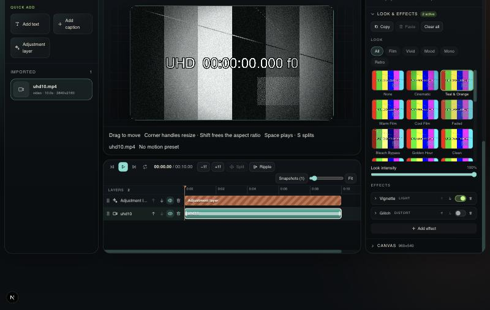

# Pixi Video Editor

A video editor that runs entirely in the browser. Import clips, cut them on a timeline, grade them with looks and effects, and export an MP4 or WebM. Nothing is uploaded: decoding, rendering and encoding all happen on your machine.

Built with Next.js, React, PixiJS and Mediabunny.



## Features

### Timeline and playback

- Real timeline with a ruler, playhead, zoom and scrubbing
- Play, pause, loop and frame stepping, with video and audio in sync
- Split a clip at the playhead, trim either edge, move clips in time
- Ripple delete to close the gap a removed clip leaves
- Edges snap to the playhead, the timeline start and other clips
- Audio waveforms on video clips, with per-clip volume and mute

### Canvas

- Video, image and text layers on a 16:9, 9:16 or 1:1 canvas
- Drag to move, corner handles to resize, rotation and opacity
- Layer order, visibility, duplicate and rename

### Looks and effects

- **25 looks** in five groups (Film, Vivid, Mood, Mono, Retro), previewed as live thumbnails of your own footage, with one intensity slider
- **37 effects** across Color, Blur, Light, Stylize, Distort and Retro, each with its own controls: colours, sizes, angles and positions rather than a single strength slider
- **Effect stack** per layer: add, reorder, switch off and remove effects
- **Animated effects**: film grain, glitch, light rays, CRT, old film and shockwave move with the playhead
- **Adjustment layers** apply a look and effects to everything beneath them for a span of time
- Copy a whole treatment from one layer and paste it onto another

### Export

- MP4 (H.264 + AAC) or WebM (VP9 + Opus)
- 1×, 2× or 4× the canvas size, at 24, 30 or 60 fps
- Every frame is rendered exactly, so the result does not depend on how fast the computer is

### Editing safety

- Undo and redo for every edit; a slider drag is a single undo step
- Version snapshots you can restore
- The project and its media are saved in the browser automatically

### AI assistant (optional)

Bring your own Claude or Gemini API key and describe an edit in plain language. The assistant proposes a plan of typed commands, you review it, and the editor validates and applies it as one undo step. Without a key, a small built-in keyword planner handles simple requests.

## Getting started

Requires Node.js 18.18 or later.

```bash
npm install
```

```bash
npm run dev
```

Open [http://localhost:3000](http://localhost:3000), upload a video or image, and start editing.

Use a Chromium-based browser (Chrome, Edge, Arc). Export relies on WebCodecs; Safari and Firefox have not been tested.

### Scripts

| Command | What it does |
| --- | --- |
| `npm run dev` | Start the development server |
| `npm run build` | Build for production |
| `npm run start` | Serve the production build |
| `npm run lint` | Run ESLint |

## Keyboard shortcuts

| Key | Action |
| --- | --- |
| `Space` | Play or pause |
| `Home` / `End` | Jump to the start or end |
| `,` / `.` | Step one frame back or forward (`Shift` for one second) |
| `S` | Split the selected layer at the playhead |
| `Delete` | Delete the selected layer |
| `Shift` + `Delete` | Ripple delete (close the gap) |
| `Cmd/Ctrl` + `D` | Duplicate the selected layer |
| `Cmd/Ctrl` + `Z` | Undo |
| `Cmd/Ctrl` + `Shift` + `Z` | Redo |

## How it works

Every edit is a typed **command** (`split_layer`, `add_effect`, `set_look`, …). The UI, the keyboard shortcuts and the AI assistant all go through the same command layer, which validates input, applies the change to an immutable project, and records it for undo, version history and the audit log.

```
src/
├── components/        React UI: timeline, inspector, export dialog, AI rail
├── store/             Zustand stores: project and history, playback, clipboard
├── lib/
│   ├── editor/        Commands, validation, timeline maths, persistence
│   ├── effects/       Effect catalogue, look library, colour maths
│   ├── renderer/      PixiJS stage, video driving, effect rendering
│   ├── export/        Frame-exact export with Mediabunny
│   ├── media/         Audio waveforms
│   └── ai/            Prompt building, provider adapters, plan validation
├── pages/             The editor page and the AI API routes
└── types/             Project, layer and command types
```

A few details worth knowing:

- **Time** lives in a separate playback store, outside undo history. Playback follows a wall clock and holds while a video buffers, so a slow decoder cannot stretch time.
- **Video** elements are created only shortly before their clip is needed, so a project cut into many pieces of one large file does not hold many decoders at once.
- **Effects** are data. The catalogue in `src/lib/effects/registry.ts` defines each effect's controls once, and the inspector, the command layer, the AI prompt and the renderer all read it.
- **Export** renders the same PixiJS stage the preview uses, one exact frame at a time, and mixes audio offline.

## Roadmap

- Keyframes for position, scale, rotation, opacity and effect values
- Transitions between clips and in/out motion presets
- Crop, clip speed and freeze frame
- Standalone audio tracks for music and voiceover
- Multi-select, canvas zoom and pan, on-canvas text editing
- Auto captions, silence removal and colour matching

## Tech stack

[Next.js 15](https://nextjs.org) · [React 19](https://react.dev) · [PixiJS 8](https://pixijs.com) · [pixi-filters](https://github.com/pixijs/filters) · [Mediabunny](https://mediabunny.dev) · [Zustand](https://zustand.docs.pmnd.rs) · TypeScript
